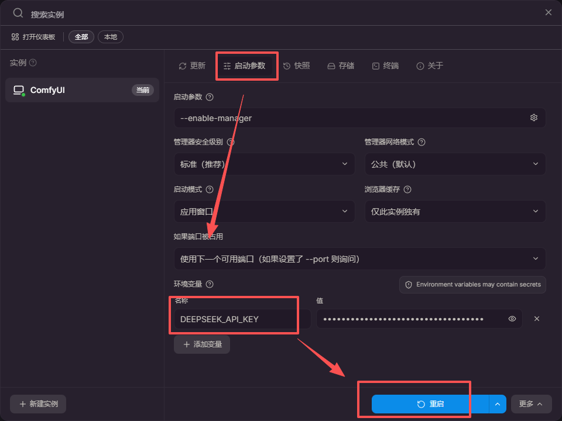
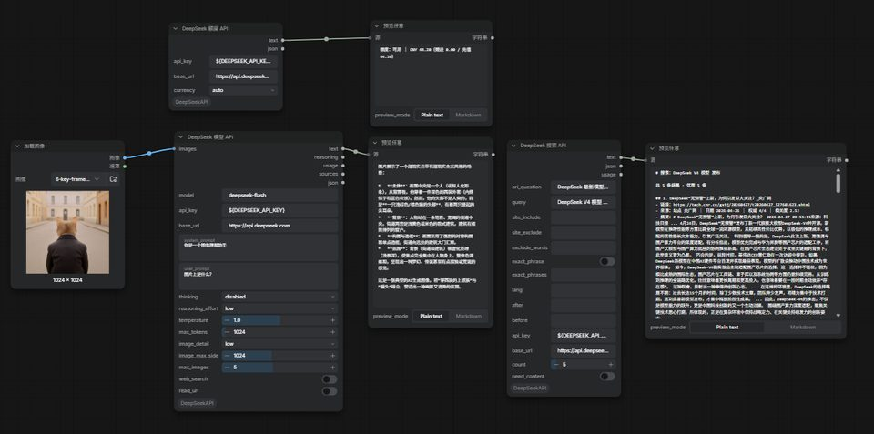

# Comfy-DeepSeekAPI

English | [中文](#中文)

## Install

1. Copy the Comfy-DeepSeekAPI folder into ComfyUI/custom_nodes/
2. Set the environment variable DEEPSEEK_API_KEY (create one at https://platform.deepseek.com/api_keys)
3. Restart ComfyUI

Requires ComfyUI v0.4.0+ (V3 nodes, comfy_api.latest, with io.Autogrow).

Node titles, descriptions and tooltips follow ComfyUI's interface language (English / 中文).

## Usage

Five nodes under Add Node → DeepSeekAPI:

| Node | What it does | Outputs |
|---|---|---|
| DeepSeek Model API | Chat + image understanding (`image_slots` autogrow or an `images` batch, capped by `max_images`) + optional web tools | text / reasoning / usage / sources / json |
| DeepSeek Search API | Web search; the query syntax is built from the filter widgets | text / usage / json |
| DeepSeek Balance API | Account balance | text / json |
| Text2SVG | Extracts the SVG from model text and returns ComfyUI's SVG type; previews it on the node | svg / svg_text / agent_prompt |
| Layer Compositor | Stacks transparent images (autogrow `image_0…7`) with a built-in canvas editor: drag, resize, rotate, snap, multi-select, reorder, undo | image / mask / layout |

Defaults favor cost and latency (thinking off, low detail, 5 images), but output length is not throttled: max_tokens defaults to the API ceiling 384K (393216). Images are sent at their original size — only images with a side over 4096 px are downscaled, and the API resizes large images to ~1300×1300 anyway.

Both image inputs accept data at once: click + on the multi-image slots group (`image_slots`, 多图插槽) to add slots, and/or feed a batch into `images`. Slot images go first, everything is merged into one request and capped by `max_images`.

Ask the model for an SVG (e.g. "output only one SVG in a fenced svg code block") and wire its text into Text2SVG: the node writes the file into the output folder and previews it in the node, and the svg socket feeds any SVG input.

**Layer Compositor**: wire transparent layers into `image_0` … `image_7` (a 4-channel input uses channel 4 as alpha), run once, then click Open Compositor (打开合成器). Arrange layers on the canvas (drag / 8 handles / rotate / snap / multi-select / reorder / undo), then hit Save & Close (保存并关闭): the layout is written back and the node runs itself once, so the preview and outputs (a 3-channel IMAGE, a MASK and the layout JSON) match what you arranged.

## Example

Workflow file: [example/workflows/Comfy-DeepSeek-API.json](example/workflows/Comfy-DeepSeek-API.json)

Open it from Workflow → Browse Templates, or drag the JSON file onto the canvas.

## Cases

- [FL2VA director agent](example/cases/fl2va-director-agent.md): a long Chinese system prompt for turning two frames (first / last) into a MiniMax H3 FL2VA shot list. Wire both frames into the model node, paste the system prompt, and ask for the description — the node is set up for long output by default. Raw prompt: [fl2va-director-system-prompt.txt](example/cases/fl2va-director-system-prompt.txt)
- [IndexTTS director prompt](example/cases/indextts-director-prompt.md): a Chinese system prompt that rewrites an idea into a dubbing script with IndexTTS segment tags. Paste it as the model node's system_prompt and feed the result to a TTS node.
- [SVG generator agent](example/cases/svg-generator-agent.md): expert system prompt that turns one sentence into a self-contained SVG (hard constraints, drawing workflow, QC checklist). Paste it into the model node and wire its text into Text2SVG — or take the node's own agent_prompt output. Raw prompt: [svg-generator-system-prompt.txt](example/cases/svg-generator-system-prompt.txt)

## Sponsor

If this plugin saves you time, buy me a coffee ☕

| Alipay | WeChat Pay |
|---|---|
|  |  |

Special thanks to **DeepSeek** for the stable and easy-to-use API.

---

## 中文

### 安装

1. 把 Comfy-DeepSeekAPI 文件夹放进 ComfyUI/custom_nodes/
2. 设置环境变量 DEEPSEEK_API_KEY（在 https://platform.deepseek.com/api_keys 创建）
3. 重启 ComfyUI

需要 ComfyUI v0.4.0 及以上（V3 节点，comfy_api.latest，含 io.Autogrow）。

节点标题、描述与 tooltip 跟随 ComfyUI 的界面语言（中文 / English）。

### 使用

五个节点，都在 Add Node → DeepSeekAPI 下：

| 节点 | 作用 | 输出 |
|---|---|---|
| DeepSeek 模型 API | 文本对话 + 图片识别（`image_slots` 多图插槽或 `images` batch，张数由 `max_images` 控制）+ 可选联网 | text / reasoning / usage / sources / json |
| DeepSeek 搜索 API | 网页搜索，语法由筛选控件自动拼 | text / usage / json |
| DeepSeek 额度 API | 查询账户余额 | text / json |
| Text2SVG | 从模型文本里取出 SVG，输出 ComfyUI 的 SVG 类型，并在节点上预览 | svg / svg_text / agent_prompt |
| 图层合成器 | 把带透明的图按顺序叠起来（autogrow `image_0…7`），内置画布编辑器：拖动、缩放、旋转、吸附对齐、多选、层级重排、撤销 | image / mask / layout |

默认参数偏省钱、快（思考关闭、低精度、默认发 5 张），但**不限制输出长度**：max_tokens 默认取接口上限 384K（393216）。图片按原尺寸发送，只有长边超过 4096 px 才兜底缩小；服务端本来就会把大图缩到约 1300×1300。

两路图片可同时接：在「多图插槽」（`image_slots`）点 + 加插槽，和/或给 `images` 接一个 batch；插槽里的图排在前面，合并成一次请求，总张数受 `max_images` 限制。

让模型输出 SVG（例如要求"只输出一个 SVG，放在 svg 代码块里"），把模型的 `text` 接到 Text2SVG：节点会把文件写到 output 目录、在节点上直接预览，`svg` 输出可接任何 SVG 输入。

**图层合成器**：把带透明的图层接到 `image_0` … `image_7`（4 通道输入用第 4 通道当 alpha），先运行一次，再点「打开合成器」。在画布里拖动 / 八点缩放 / 旋转 / 吸附对齐 / 多选 / 调层级 / 撤销，点「保存并关闭」——布局写回 widget 后节点会自动跑一次，预览和输出（3 通道 IMAGE + MASK + 布局 JSON）就和你摆的一致。

### 示例

工作流文件：[example/workflows/Comfy-DeepSeek-API.json](example/workflows/Comfy-DeepSeek-API.json)

可从 Workflow → Browse Templates 打开，或直接把 JSON 拖进画布。

### 案例

- [FL2VA 导演 Agent](example/cases/fl2va-director-agent.md)：把首/尾两帧 + 一段文本意图变成 MiniMax H3 FL2VA 分镜的中文系统提示词。模型节点接两张图、把系统提示词粘进去即可；默认已按长输出配置。原始提示词：[fl2va-director-system-prompt.txt](example/cases/fl2va-director-system-prompt.txt)
- [IndexTTS 导演提示词](example/cases/indextts-director-prompt.md)：把意图/梗概改写成带段标语法的配音剧本；粘进模型节点的 `system_prompt`，输出直接喂 TTS 节点。
- [SVG 生成 Agent](example/cases/svg-generator-agent.md)：专家级系统提示词，把一句话需求变成自包含 SVG（硬约束 + 绘制流程 + 12 项质检）。接到模型节点，text 再接 Text2SVG；也可以直接用 Text2SVG 的 `agent_prompt` 输出。原始提示词：[svg-generator-system-prompt.txt](example/cases/svg-generator-system-prompt.txt)

### 支持这个项目

如果它帮你省了时间，欢迎请我喝杯咖啡 ☕

| 支付宝 | 微信支付 |
|---|---|
|  |  |

特别鸣谢 **DeepSeek** 提供稳定、好用的 API 服务。

